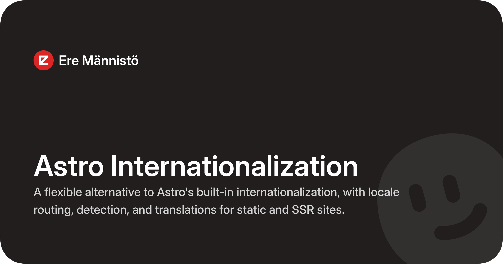

# Astro Internationalization




Locale routing, locale detection and translations for Astro. An alternative to the native i18n of Astro, for static, hybrid and server sites.

## Install

```bash
npm install @mannisto/astro-i18n
```

## Setup

### Add the integration

```typescript
// astro.config.ts
import i18n from "@mannisto/astro-i18n"
import { defineConfig } from "astro/config"

export default defineConfig({
  integrations: [
    i18n({
      locales: [
        {
          code: "en",
          name: "English",
          endonym: "English",
          phrase: "In English",
        },
        {
          code: "fi",
          name: "Finnish",
          endonym: "Suomi",
          phrase: "Suomeksi",
        },
      ],
      defaultLocale: "en",
      prefixDefaultLocale: false,
      translations: "./src/translations",
    }),
  ],
})
```

| Option | Default | Description |
|---|---|---|
| `locales` | — | The languages of the site. |
| `defaultLocale` | The first locale | The default language. |
| `prefixDefaultLocale` | `false` | Whether the URLs of the default language use a language prefix, for example `/en/about`. The other languages always use one. |
| `translations` | — | The folder with the translation files. |

Each locale has these fields:

| Field | Description |
|---|---|
| `code` | The locale code, for example `"en"`. |
| `name` | Optional. The name of the language, for example `"English"`. |
| `endonym` | Optional. The name of the language in that language, for example `"Suomi"`. |
| `phrase` | Optional. A short label for a language switcher, for example `"In English"`. |
| `direction` | Optional. `"ltr"` (default) or `"rtl"`. |

### Add the locale pages

Put all pages that have a version in each locale into a `[locale]` folder. The `prefixDefaultLocale` option decides their URLs.

```
src/pages/
├── [locale]/
│   ├── index.astro
│   └── about.astro
└── 404.astro
```

```astro
---
// src/pages/[locale]/index.astro
import { Locale } from "@mannisto/astro-i18n/runtime"

// Static and hybrid sites only. Server pages do not need this.
export const getStaticPaths = () => {
  return Locale.supported.map((code) => {
    return {
      params: {
        locale: code,
      },
    }
  })
}

const { code, t } = Locale.use(Astro)
---

<html lang={code}>
  <body>
    <h1>{t("nav.home")}</h1>
  </body>
</html>
```

A page outside the `[locale]` folder, for example `src/pages/privacy.astro`, keeps its URL and has no locale.

### Add the 404 page

Add `src/pages/404.astro`. The site needs it: the integration sends all URLs without a page to it. For example:

- `/de/about`, when `de` is not a locale of the site
- `/en/about`, when `prefixDefaultLocale` is `false`

Without the page, visitors see the default error page of the host.

```astro
---
// src/pages/404.astro
import { LocaleRedirect } from "@mannisto/astro-i18n/components"
---

<html>
  <head>
    <LocaleRedirect />
  </head>
  <body>
    <h1>404</h1>
  </body>
</html>
```

All locales use this one page. `<LocaleRedirect>` is necessary only for static sites with `prefixDefaultLocale: true`. A static host has no server, so the redirect from `/about` to `/en/about` happens in the browser, on this page. In all other setups, the component does nothing.

### Add the translations

Add one JSON file for each locale to the `translations` folder, for example `src/translations/en.json` and `src/translations/fi.json`. Use flat keys.

```json
{
  "nav.home": "Home",
  "nav.about": "About",
  "greeting": "Hello {{user}}"
}
```

`t` from `Locale.use(Astro)` returns the text of the current locale. Give the values of the `{{name}}` placeholders in the second argument.

```astro
---
import { Locale } from "@mannisto/astro-i18n/runtime"

const { t } = Locale.use(Astro)
---

<!-- Hello World -->
<h1>{t("greeting", { user: "World" })}</h1>
```

- **A missing key:** `t` returns the key name and logs an error. At startup, the integration also shows a warning for each key that a locale does not have.
- **A missing value:** the placeholder stays in the text, and `t` logs an error.
- **Only on the server:** for React, Vue and other frameworks, give the translated text as a prop.

> [!WARNING]
> `t` does not escape the values. Astro escapes text in templates, but not with `set:html`. Do not use `set:html` with values from visitors.

### Add the layout

Add `<LocaleCookie>` and `<LocaleHreflang>` to the layout of the locale pages:

- `<LocaleCookie>` stores the current locale. With `prefixDefaultLocale: true`, the next visit to `/` goes to the same locale.
- `<LocaleHreflang>` adds the links to the other locales for search engines.

```astro
---
// src/layouts/Layout.astro
import { LocaleCookie, LocaleHreflang } from "@mannisto/astro-i18n/components"
import { Locale } from "@mannisto/astro-i18n/runtime"

const { code } = Locale.use(Astro)
---

<html lang={code}>
  <head>
    <LocaleCookie locale={code} />
    <LocaleHreflang url={Astro.url} site={Astro.site ?? Astro.url.origin} />
  </head>
  <body>
    <slot />
  </body>
</html>
```

Now you can build the site. Use `Locale.url()` for all links between pages, see [Good to know](#good-to-know).

## Sitemap

With `prefixDefaultLocale: false`, `@astrojs/sitemap` lists the pages of the default locale with their prefix, for example `/en/about`. These URLs give a 404. Remove the prefix with the `serialize` option. For example, with `en` as the default locale:

```typescript
sitemap({
  serialize(item) {
    item.url = item.url.replace("/en/", "/")
    item.links = item.links?.map((link) => {
      return {
        ...link,
        url: link.url.replace("/en/", "/"),
      }
    })
    return item
  },
})
```

`item.links` has the language versions of a page when you use the `i18n` option of the sitemap.

## API

`Locale.use(Astro)` returns the current locale: `{ code, name, endonym, phrase, direction, t }`.

| Method | Returns | Description |
|---|---|---|
| `Locale.supported` | `string[]` | All locale codes |
| `Locale.defaultLocale` | `string` | The default locale code |
| `Locale.get()` | `LocaleConfig[]` | All locale configs |
| `Locale.get("fi")` | `LocaleConfig` | The config of one locale |
| `Locale.fromURL(url)` | `string` | The locale code of a URL |
| `Locale.url("fi", "/about")` | `string` | The URL path of a page in a locale |
| `Locale.switch("fi")` | `void` | Stores the locale and opens the page in that locale (browser only) |
| `Locale.hreflang(url, site)` | `{ href, hreflang }[]` | The hreflang links for all locales and `x-default` |

| Component | Props |
|---|---|
| `<LocaleCookie>` | `locale`, `age` (seconds, default 1 year) |
| `<LocaleHreflang>` | `url`, `site` |
| `<LocaleRedirect>` | — |

Import the types from the package, for example `import type { LocaleConfig } from "@mannisto/astro-i18n"`.

## How to make a language switcher

The package has no switcher component, because each site has its own design. Make one with `Locale.get()` and `Locale.switch()`:

```astro
---
import { Locale } from "@mannisto/astro-i18n/runtime"
---

{
  Locale.get().map((locale) => {
    return (
      <button data-locale={locale.code}>
        {locale.phrase ?? locale.endonym ?? locale.code}
      </button>
    )
  })
}

<script>
  import { Locale } from "@mannisto/astro-i18n/runtime"

  for (const button of document.querySelectorAll("button[data-locale]")) {
    button.addEventListener("click", () => {
      const code = button.getAttribute("data-locale")
      if (code) Locale.switch(code)
    })
  }
</script>
```

## Good to know

- **The default language without a prefix.** With `prefixDefaultLocale: false`, `/en/about` gives a 404.
- **The root page with a prefix.** With `prefixDefaultLocale: true`, `/` sends the visitor to the language that they used last, or to the default language. To show your own page at `/`, for example a language selector, add `src/pages/index.astro`.
- **Links.** Use `Locale.url()` to make links. With `prefixDefaultLocale: false`, `Astro.url` still contains the prefix of the default locale.
- **Trailing slash.** `Locale.url()` and the hreflang links follow the `trailingSlash` option of Astro.
- **Middleware order.** The middleware of the integration runs before your own `src/middleware.ts`.
- **Dev and build.** Dev and the build give the same URLs, in static, hybrid and server mode.

## Migrate from v2

Version 3 has four breaking changes.

### Keep the v2 URLs

The default locale has no URL prefix by default: `/about` in place of `/en/about`. To keep the v2 URLs, set `prefixDefaultLocale` to `true`.

```diff
i18n({
  locales: [...],
+ prefixDefaultLocale: true,
})
```

### Remove the `response()` call from the 404 page

The middleware now does the redirects. The 404 page does not need `response()` or `prerender = false`.

```diff
---
- export const prerender = false
-
import { Locale } from "@mannisto/astro-i18n/runtime"

- const { code, response } = Locale.use(Astro)
- const redirect = response()
- if (redirect) return redirect
+ const { code } = Locale.use(Astro)
---
```

### Remove the `ignore` option

The middleware now skips all pages outside the `[locale]` folder, for example API routes. Remove `ignore` from your config.

```diff
i18n({
  locales: [...],
- ignore: ["/api"],
})
```

### Update Astro

The integration needs Astro 6.4.6 or later, or Astro 7.

## Contributing

Read [CONTRIBUTING.md](./CONTRIBUTING.md) for the setup and the test commands. Report bugs and ideas in [GitHub issues](https://github.com/eremannisto/astro-i18n/issues).

## License

MIT © [Ere Männistö](https://github.com/eremannisto)
